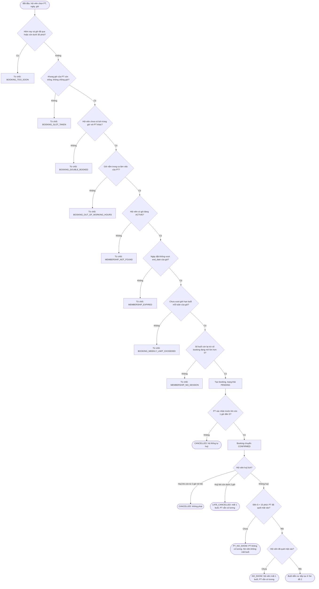
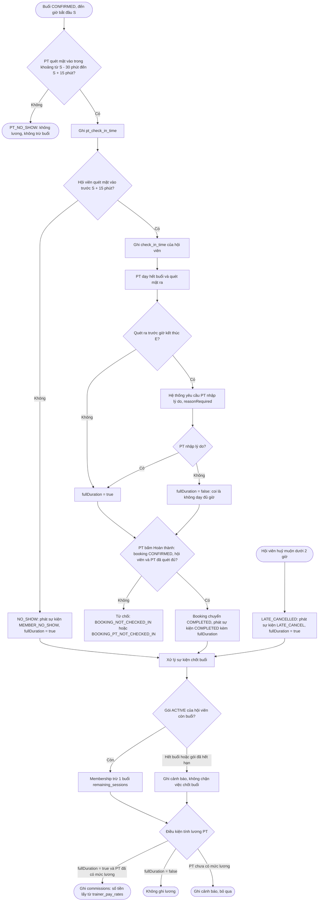

# ACTIVITY_DIAGRAMS.md — Luồng nghiệp vụ của hai chức năng phức tạp nhất

> Phục vụ **Bước 1, tiêu chí "Luồng nghiệp vụ" (15%)**: mô hình hoá 1 đến 2 chức năng phức tạp nhất, có xử lý nhánh ngoại lệ.
> Nguồn quy tắc: `REQUIREMENTS.md` mục 2, 3 và `docs/CHANGE_PT_ATTENDANCE_AND_PAY.md`. Ký hiệu: **S** là giờ bắt đầu buổi, **E** là giờ kết thúc; hình bầu dục là điểm kết thúc của luồng; nhánh đỏ ghi mã lỗi là ngoại lệ bị từ chối.
> Sơ đồ vẽ bằng Mermaid (GitHub tự hiển thị). Muốn xuất ảnh cho slide: dán phần code vào https://mermaid.live rồi chọn xuất PNG hoặc SVG.

## Sơ đồ 1 — Đặt lịch PT và vòng đời booking

Chức năng này có nhiều nhánh kiểm tra tuần tự (8 điều kiện từ chối) và nhiều trạng thái kết thúc theo thời gian.

**Ghi chú:** hội viên huỷ booking còn `PENDING` luôn miễn phí (PT chưa cam kết); PT huỷ thì `CANCELLED`, không lương, không trừ buổi. Việc chuyển trạng thái theo thời gian dùng lazy-check, chạy mỗi khi có người đọc booking hoặc có lượt quét mặt, không cần cron.

## Sơ đồ 2 — PT điểm danh, chốt buổi, trừ buổi và tính lương

Chức năng này nối Booking với Membership (trừ buổi) và Lương PT qua một sự kiện chốt buổi, có nhánh ra sớm có hoặc không có lý do.

**Ghi chú:** bước trừ buổi và ghi lương chạy đồng bộ trong cùng transaction với việc chốt buổi, nên chúng **không được ném lỗi** (nếu ném, PT không chốt được buổi chỉ vì hội viên hết buổi hay PT chưa có mức lương), chỉ ghi cảnh báo. Mỗi booking tối đa một bản ghi lương (`commissions.booking_id` là UNIQUE), nên chốt hai lần không trả lương hai lần. Quy tắc cho trường hợp PT không bấm "Hoàn thành" sau giờ kết thúc đang chờ Phi quyết định, chưa vẽ.
