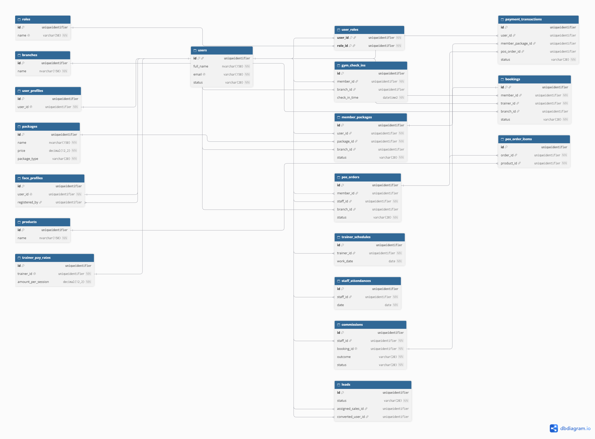

# Tài liệu phân tích và thiết kế — Gym Management System (GMS)

Hệ thống quản lý phòng gym (Spring Boot, SQL Server 2022, Redis), đồ án môn Software Engineering. Thư mục này gom toàn bộ tài liệu **Bước 1 (phân tích yêu cầu)** và **Bước 2 (thiết kế cơ sở dữ liệu và ERD)**.

## 1. Tài liệu theo tiêu chí chấm

### Bước 1 — Phân tích yêu cầu (40%)
| Tiêu chí | Tài liệu |
|---|---|
| Tác nhân (10%): 6 tác nhân, giới hạn quyền hạn từng tác nhân | [USER_STORIES.md](USER_STORIES.md) (mục Tác nhân) |
| Danh sách use case / user story (15%): 88 story, dạng Động từ + Danh từ | [USER_STORIES.md](USER_STORIES.md) |
| Luồng nghiệp vụ (15%): 2 chức năng phức tạp nhất, có nhánh ngoại lệ | [ACTIVITY_DIAGRAMS.md](ACTIVITY_DIAGRAMS.md) |

### Bước 2 — Thiết kế cơ sở dữ liệu và ERD (60%)
| Tiêu chí | Tài liệu |
|---|---|
| Thực thể và thuộc tính (20%): 19 bảng, kiểu dữ liệu, nullable, mặc định | [DATABASE_SCHEMA.md](../DATABASE_SCHEMA.md) (từ điển cột), [database/gms_schema_v2.sql](database/gms_schema_v2.sql) (script DDL) |
| Khoá PK và FK (15%): 19/19 bảng có PK, 28 khoá ngoại | [ERD_TONG_QUAT.md](ERD_TONG_QUAT.md), [database/dbml/](database/dbml/), script DDL |
| Mối quan hệ (15%): 1-1, 1-N, N-N tách bằng bảng trung gian | [DB_DESIGN_REVIEW.md](DB_DESIGN_REVIEW.md) mục 3, ERD |
| Chuẩn hoá (10%): 2NF/3NF và giải trình các cột cố ý giữ | [DB_DESIGN_REVIEW.md](DB_DESIGN_REVIEW.md) mục 4 |
| Phủ use case: mỗi story dùng những bảng nào | [DB_DESIGN_REVIEW.md](DB_DESIGN_REVIEW.md) mục 5 và 6 |

## 2. Sơ đồ ERD


### Sơ đồ vẽ trên dbdiagram.io (thiết kế v2, 19 bảng)




| Sơ đồ | Ảnh | Mã nguồn DBML |
|---|---|---|
| Tổng quan (chỉ cột khoá, 19 bảng) | [gms_v2_0_overview.png](database/dbdiagram/gms_v2_0_overview.png) | [gms_v2_0_overview.dbml](database/dbml/gms_v2_0_overview.dbml) |
| Người dùng và gói tập | [gms_v2_1_nguoidung_goitap.png](database/dbdiagram/gms_v2_1_nguoidung_goitap.png) | [gms_v2_1_nguoidung_goitap.dbml](database/dbml/gms_v2_1_nguoidung_goitap.dbml) |
| Lịch tập, điểm danh, lương | [gms_v2_2_lichtap_diemdanh_luong.png](database/dbdiagram/gms_v2_2_lichtap_diemdanh_luong.png) | [gms_v2_2_lichtap_diemdanh_luong.dbml](database/dbml/gms_v2_2_lichtap_diemdanh_luong.dbml) |
| Thanh toán và bán lẻ | [gms_v2_3_thanhtoan_banle.png](database/dbdiagram/gms_v2_3_thanhtoan_banle.png) | [gms_v2_3_thanhtoan_banle.dbml](database/dbml/gms_v2_3_thanhtoan_banle.dbml) |
| Đầy đủ cột, một sơ đồ | [gms_v2_full.png](database/dbdiagram/gms_v2_full.png) | [gms_v2_schema.dbml](database/dbml/gms_v2_schema.dbml) |

Mã nguồn DBML dán được vào dbdiagram.io để vẽ lại.
- Bản Mermaid có chú giải và trạng thái triển khai: [ERD_TONG_QUAT.md](ERD_TONG_QUAT.md).

## 3. Trạng thái triển khai

Thiết kế mục tiêu **v2 gồm 19 bảng** (đã duyệt). Cơ sở dữ liệu đang chạy trên nhánh chính tạo bằng các migration Flyway ở `src/main/resources/db/migration`; các bảng còn lại được merge dần theo từng module:

| Migration | Nội dung |
|---|---|
| V1, V2, V2_1, V2_2 | `roles`, `users`, `user_roles`, `branches`, `packages`, `member_packages`, `user_profiles`, `payment_transactions` |
| V3 | `trainer_schedules`, `bookings` |
| V4 | `face_profiles`, `staff_attendances` |
| V5 | `products`, `pos_orders`, `pos_order_items`, `trainer_pay_rates`, `commissions` |
| V6 | `leads` |
| V7, V8, V9 | Thay đổi v2: tách khoá ngoại `payment_transactions`, bảng `gym_check_ins`, chuẩn hoá `users` và `user_profiles` (xem [DATABASE_SCHEMA.md](../DATABASE_SCHEMA.md) mục 4) |

Toàn bộ 19 bảng có thể tạo một lần bằng [database/gms_schema_v2.sql](database/gms_schema_v2.sql).

## 4. Chạy thử script thiết kế

Dùng một database trống riêng (không dùng `gms_db`). Cần Docker và container SQL Server của dự án (`docker compose up -d`):

```powershell
docker exec gms-sqlserver /opt/mssql-tools18/bin/sqlcmd -S localhost -U sa -P "GmsStrongP@ss123" -C -Q "CREATE DATABASE gms_design_check"
docker cp docs/database/gms_schema_v2.sql gms-sqlserver:/tmp/gms_schema_v2.sql
docker exec gms-sqlserver /opt/mssql-tools18/bin/sqlcmd -S localhost -U sa -P "GmsStrongP@ss123" -C -d gms_design_check -i /tmp/gms_schema_v2.sql -b
docker exec gms-sqlserver /opt/mssql-tools18/bin/sqlcmd -S localhost -U sa -P "GmsStrongP@ss123" -C -d gms_design_check -Q "SELECT COUNT(*) AS tables_count FROM sys.tables; SELECT COUNT(*) AS fk_count FROM sys.foreign_keys"
docker exec gms-sqlserver /opt/mssql-tools18/bin/sqlcmd -S localhost -U sa -P "GmsStrongP@ss123" -C -Q "DROP DATABASE gms_design_check"
```
Kết quả đúng: `tables_count` là 19 và `fk_count` là 28.

## 5. Các tài liệu khác

[DATABASE_SCHEMA.md](../DATABASE_SCHEMA.md), [REQUIREMENTS.md](../REQUIREMENTS.md), [API_DESIGN.md](../API_DESIGN.md), [TASK_ASSIGNMENT.md](../TASK_ASSIGNMENT.md), [CHANGE_PT_ATTENDANCE_AND_PAY.md](CHANGE_PT_ATTENDANCE_AND_PAY.md) (thay đổi nghiệp vụ điểm danh PT và lương PT).
